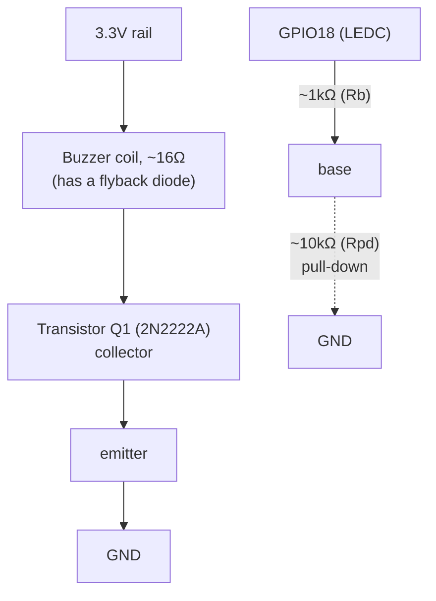

# 3.4 — Non-blocking buzzer audio player (ESP32-S3, ESP-IDF)

**Task:** play a melody on a passive buzzer via PWM (LEDC), advancing on a
fixed 50 ms tick, with no `vTaskDelay`/blocking calls and no dedicated
FreeRTOS task for playback.

## Contents

- [Hardware](#hardware)
- [PWM / LEDC concepts](#pwm--ledc-concepts)
- [Firmware architecture](#firmware-architecture)
- [ESP32-S3 pitfalls hit today](#esp32-s3-specific-pitfalls-hit-today)
- [STM32 portability notes](#stm32-portability-notes)

## Hardware

### Buzzer identification

- 3-pin Keyes-style module (`+ / - / S` silkscreen, shared with the LDR
  module in this kit — hence "not LDR" in the lecture notes).
- `+` measured open (OL) in every direction — unused on this specific
  board, despite the standard silkscreen.
- `S` and `-` are the buzzer's two functional leads. Multimeter across
  them: wobbly reading one way (a built-in flyback diode), clean **16 Ω**
  the other way (the coil itself) → **electromagnetic (coil) buzzer**, not
  piezo.
- At 3.3 V: `I = V / R = 3.3 / 16 ≈ 206 mA`, far beyond the ESP32-S3
  GPIO's ~40 mA absolute max — why it warmed up wired straight to the
  3.3 V rail, and why it can't be driven directly from a GPIO.

### Driver circuit (NPN transistor as a low-side switch)



- Buzzer's two leads: one to 3.3 V, the other to the transistor's
  **collector**. Neither buzzer lead goes to GND directly — the emitter is
  wired to GND separately. Buzzer minus and collector are the *same node*
  (plain wire, no component between); a nonzero reading there means a
  broken connection, not normal operation.
- `Rpd` (~10 kΩ, base → GND) stops a floating base from picking up noise
  and weakly, intermittently turning the transistor on (a faint, sporadic
  squeak) whenever the GPIO isn't actively driving the pin.

### Transistor orientation — why C and E aren't interchangeable

An NPN conducts in normal (forward-active/saturation) mode when the
base-emitter junction is forward-biased and the collector sits at a
**higher potential** than the emitter — current flows in through the
collector, out through the emitter. Practically: the higher-potential/load
side is the **collector**; the common/return side is the **emitter**.

The two regions are physically asymmetric (different doping), so running
it "backwards" still conducts, but current gain (hFE) collapses from
~100–300 down to single digits — same base current, buzzer stays silent
or barely audible instead of getting its full ~206 mA.

### Base resistor sizing

```
Ib = (V_GPIO − V_BE) / Rb = (3.3 − 0.7) / 1000 ≈ 2.6 mA
```

Needs `Ib × hFE ≥ Ic_sat` (≈206 mA here) to fully saturate the transistor,
with margin for hFE variation across parts/temperature.

| Rb too small | Rb too large | 1 kΩ (chosen) |
|---|---|---|
| base current itself may exceed GPIO's ~40 mA rating | not enough base current — transistor never fully saturates, buzzer runs quieter | comfortably in the safe, saturated zone |

## PWM / LEDC concepts

- **Duty cycle** (`коефіцієнт заповнення`) = fraction of the period the
  signal is high (`t_high / T`). Not the same as `шпаруватість` (the
  Ukrainian EE term for duty *ratio*), which is the reciprocal
  (`T / t_high`) — the LEDC `duty` register implements duty cycle, not
  the inverse.
- A GPIO under PWM is **always** either 0 V or 3.3 V — never an
  intermediate analog voltage. What the load perceives depends on the
  load: an LED/motor integrates switching into an effective average
  (`V_avg = duty × V_max`); a resonant transducer like this buzzer
  responds to the *switching frequency itself* (pitch) — duty cycle
  mostly reshapes harmonic content rather than acting as a volume knob,
  hence firmware fixes duty at 50% and only varies frequency per note.

### LEDC duty register formula

```
DUTY_50PCT = (1 << LEDC_RES_BITS) / 2
```

`1 << bits` = `2^bits` = total discrete steps the LEDC counter
distinguishes at that resolution (1024 at 10 bits). Dividing by 2 gives
the register value at the midpoint — the register is an integer step
count, not a direct percentage.

## Firmware architecture

- **HAL split for portability:** `audio_player.c/.h` — state machine
  only, no ESP-IDF includes at all (`stdint.h`, `stddef.h`, `stdbool.h`
  only). `buzzer_hal.h` declares the interface (`buzzer_hal_init`,
  `buzzer_hal_set_tone`). `buzzer_ledc.c` is the only file that includes
  `driver/ledc.h`. Porting to STM32 later means rewriting just the HAL
  implementation file — player logic and `main.c` stay unchanged.
- **Player state machine:** `player_start()` arms the first note and
  returns immediately. `player_tick()` is called once per real 50 ms
  tick by the *caller* — decrements `ticks_left`, advances to the next
  note at zero. Prefix `--`/`++` are required, not stylistic: postfix
  would compare/index using the *pre*-decrement/increment value, causing
  an extra tick per note and an out-of-bounds read on the last note.
- **Tick source (superloop):**
  ```
  next = esp_timer_get_time() + TICK_MS * 1000   // declared ONCE, before the loop
  loop forever:
      now = esp_timer_get_time()
      if now - next >= 0:
          next += TICK_MS * 1000                  // += period, never = now (avoids drift)
          player_tick()
  ```
  Common bug: declaring `next` *inside* the loop re-arms the deadline
  every iteration, so the tick condition is never true and playback
  freezes on the first note.

## ESP32-S3-specific pitfalls hit today

- **LEDC low-speed only** — the S3 has no high-speed LEDC group (unlike
  the original ESP32); always `LEDC_LOW_SPEED_MODE`.
- **`clk_cfg = LEDC_AUTO_CLK`** lets the driver pick a clock source able
  to satisfy `freq_hz` + `duty_resolution` together — worth checking this
  succeeds at the melody's *highest* note.
- **`ledc_timer_config` with `freq_hz = 0`** fails (`ESP_FAIL` — no valid
  clock pre-divider for 0 Hz), panicking the app via `ESP_ERROR_CHECK` at
  boot. Use any real placeholder frequency; `duty = 0` already keeps it
  silent until the first note plays.
- **Task watchdog (TWDT) on IDLE0** — a non-yielding superloop in
  `app_main` starves the CPU0 idle task, which must periodically feed the
  watchdog. Fix: `CONFIG_ESP_TASK_WDT_CHECK_IDLE_TASK_CPU0=n` (menuconfig
  search with `/`, or directly in `sdkconfig.defaults`) — a deliberate
  trade-off given the assignment's no-delay constraint, not a workaround
  for a real bug.

## STM32 portability notes

| ESP32-S3 (LEDC) | STM32 equivalent |
|---|---|
| `ledc_set_freq` | write `PSC`/`ARR` on `TIMx` |
| duty register / `duty_resolution` | `CCR` register / `ARR` (resolution = `ARR` itself) |
| `hpoint` (phase offset) | manual `CNT`/`CCR` manipulation |
| `clk_cfg = LEDC_AUTO_CLK` | no auto-select — clock tree (`RCC`) and `PSC` chosen explicitly |
| `sleep_mode` (`LEDC_SLEEP_MODE_*`) | no direct equivalent — sleep behavior set via `RCC` clock domains |
| `esp_timer` / TWDT | SysTick (`HAL_GetTick`) or a basic timer (e.g. TIM6); no idle-task watchdog concept |
